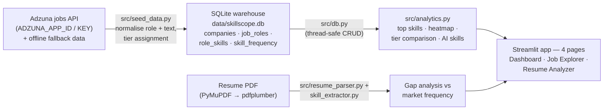

# SkillScope

Job-market skill-demand analytics: an SQLite warehouse of companies, role titles and skill frequencies (seeded via the Adzuna jobs API with an offline fallback), explored through Streamlit dashboards — skill demand, role × category heatmap, company-tier comparison, an AI-skills spotlight, and a resume-gap analyzer.


## The problem

Job seekers guess which skills to learn. Job postings encode the answer, but the signal is spread
across thousands of listings and company sites. SkillScope aggregates postings into a small
skill-frequency warehouse and answers concrete questions: which skills appear most often, how
demand differs by role and company tier, how much AI/GenAI vocabulary shows up, and which skills
*your* resume is missing for a given role.

## Architecture



**Warehouse contents (queried from the committed `data/skillscope.db`, 2026-10-06):**
11,881 companies (most bucketed as `Other` via API seeding; 115 curated across six named tiers —
Product, Indian IT, Startup, Consulting, EdTech, Esports), 29,291 job-role rows across 15 curated
role titles, 145,200 role-skill pairs, and 269 tracked skills with frequencies.

- **Seeding** (`src/seed_data.py`): queries Adzuna per company + role, normalises titles and text,
  assigns tiers, and guarantees coverage with a built-in fallback so seeding never fails without
  credentials. A Kaggle download path exists in the file but is commented out — Adzuna + fallback
  is the active strategy.
- **Analytics** (`src/analytics.py`): top skills (default limit 20, filterable by category), role
  skill aggregation, tier comparison, and the AI & Emerging Skills Spotlight
  (`skill_category = 'AI & GenAI'`).
- **Resume gap analyzer** (`pages/resume_analyzer.py`, `src/resume_parser.py`,
  `src/skill_extractor.py`, `src/skill_taxonomy.py`): extracts PDF text (PyMuPDF first,
  pdfplumber fallback), matches skills against the taxonomy, and diffs them against market
  frequency for the chosen role.

## How to run locally

```cmd
python -m venv .venv
.venv\Scripts\pip install -r requirements.txt
copy .env.example .env
.venv\Scripts\streamlit run app.py
```

The app works out of the box — the warehouse is committed at `data/skillscope.db` so Streamlit
Cloud can serve it without a database service. To re-seed instead, put your Adzuna credentials in
`.env` (`ADZUNA_APP_ID`, `ADZUNA_APP_KEY`; optional `KAGGLE_API_TOKEN`) and run
`.venv\Scripts\python src\seed_data.py`. Credentials are optional: without them the fallback data
seeds the warehouse.

## Tests

Run with `.venv\Scripts\python -m pytest -q`. Verified 2026-10-06:

- **64 passed, 1 failed** across the 7 runnable test modules (pytest + hypothesis). The failure,
  `test_config_files.py::test_gitignore_excludes_db`, asserts the database should be gitignored —
  but the repo deliberately commits `data/skillscope.db` for Streamlit Cloud persistence, so the
  test and the repo strategy disagree. Left as-is (out of scope).
- `tests/test_pipeline_cleaning.py` fails at **collection** with a stale import
  (`VALID_ROLES` no longer exists in `src/seed_data.py`), which aborts a full-suite run; run with
  `--ignore=tests/test_pipeline_cleaning.py` until fixed.

## Data sources

- **Adzuna jobs API** — <https://developer.adzuna.com/> — job postings queried per company/role at
  seed time (free API key required; see Adzuna's own terms of use).
- **Built-in fallback dataset** — hand-written company/role/skill data in `src/seed_data.py` used
  when credentials are absent.
- A Kaggle job-postings download is present but commented out; it is not part of the active
  pipeline.

## Limitations

- The dashboard's caption text says "91 companies and 15 job roles"; the committed warehouse
  actually holds 11,881 companies (115 curated, rest `Other`) and 29,291 role rows. The caption is
  code (out of scope here) — trust the counts in this README, which come from the database.
- "Real-time" claims are avoided deliberately: the warehouse is a committed snapshot, refreshed
  only when the seed pipeline is run.
- Skill frequency counts derive from seeded postings, not a census of the job market.
- The Streamlit Community Cloud URL exists in the repo history but currently redirects to
  Streamlit's login wall, so no live link is included here.

## Project structure

```
SkillScope/
├── app.py                    # Home page; reads secrets → env fallback
├── pages/
│   ├── dashboard.py          # Skill demand, heatmap, tier comparison, AI spotlight
│   ├── job_explorer.py       # Company cards, role drill-down, skill consensus
│   └── resume_analyzer.py    # PDF upload, gap analysis, market frequency chart
├── src/
│   ├── db.py                 # Thread-safe SQLite CRUD layer
│   ├── analytics.py          # SQL analytics (top skills, tiers, AI skills)
│   ├── seed_data.py          # Adzuna + fallback seeding pipeline
│   ├── resume_parser.py      # PDF text extraction (PyMuPDF → pdfplumber)
│   ├── skill_extractor.py    # Resume skill matching
│   └── skill_taxonomy.py     # Skill categories / canonical names
├── data/
│   ├── skillscope.db         # Committed SQLite warehouse (Streamlit Cloud persistence)
│   └── seed_data.json        # Seed payload
├── tests/                    # pytest + hypothesis (8 modules; see Tests section)
└── .env.example              # Adzuna + Kaggle credential placeholders
```

## Licence

MIT — see [LICENSE](LICENSE).
